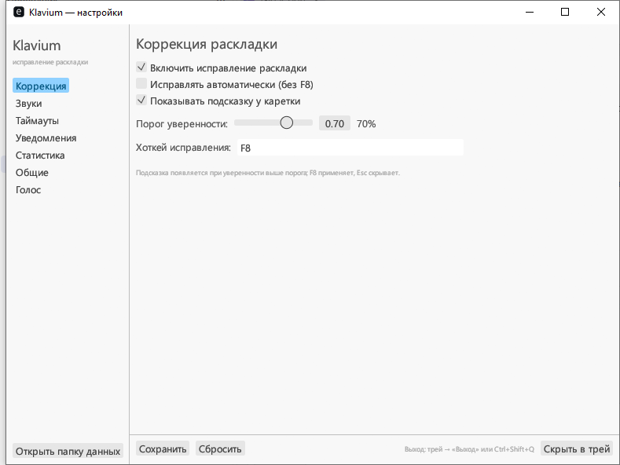
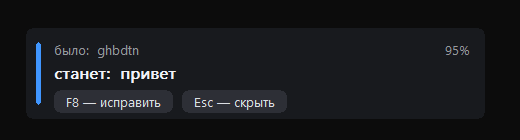
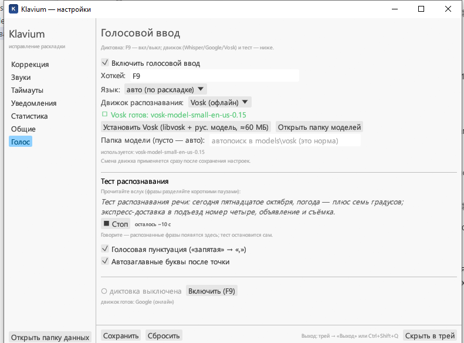
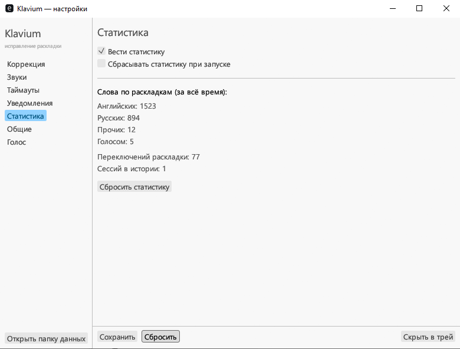
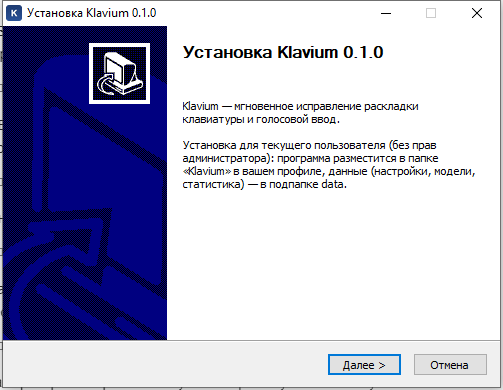

# Klavium

**Klavium** — лёгкая фоновая утилита для Windows, которая следит за вводом с клавиатуры и сама исправляет слова, набранные не в той раскладке: набрали `ghbdtn` — получите `привет`. Плюс голосовой ввод: нажали `F9` — говорите, текст печатается сам.

Задумана как «Punto Switcher на современный лад»: нативный Rust, мгновенный старт, портативные данные, офлайн-распознавание речи — без облаков и подписок.

> Windows 10/11 (x64) · нативный Rust · офлайн-диктовка · MIT OR Apache-2.0



## Возможности

### ⌨️ Исправление раскладки
- Слово, набранное не в той раскладке, распознаётся по встроенным словарям (сотни тысяч русских и английских слов) и проверке биграмм — и исправляется в обе стороны.
- У курсора появляется карточка «было → станет» с уверенностью: `F8` — исправить, `Esc` — скрыть. Можно включить и полную автоматику без подтверждения.
- Настраиваемый порог уверенности (по умолчанию 70%).
- Всё локально: никакие нажатия никуда не отправляются.



### 🎤 Голосовой ввод (`F9`)
- Три движка на выбор: **Whisper** (полностью офлайн, модели от 74 МБ до ~1,5 ГБ — скачиваются прямо из настроек), **Vosk** (офлайн, русская модель ставится в один клик), **Google** (онлайн).
- Голосовая пунктуация: скажите «запятая» — появится «,». Поддерживаются «точка», «вопросительный знак», «новая строка», «тире» и другие.
- Команды: «стоп» — завершить диктовку, «пауза» и «продолжить» — приостановка и возобновление.
- Автозаглавные буквы после точки.
- Встроенный «Тест распознавания»: прочитайте контрольную фразу и сразу увидите результат.



### 🔔 Живая обратная связь
- Тост при переключении раскладки: `ENGLISH` — синий, `РУССКИЙ` — красный.
- Звуковые сигналы на смену слова/раскладки и на старт/остановку диктовки (частота и длительность настраиваются).
- Иконка в трее меняет цвет по текущей раскладке; меню: «Настройки», «Статистика», «Голосовой ввод», «Выход».


### 📊 Статистика
- Слова по раскладкам (английские и русские), переключения раскладки, слова, надиктованные голосом, история сессий.
- Счётчики за всё время; можно сбросить или отключить ведение статистики.



## Установка

**Вариант 1 — установщик (рекомендуется).** Возьмите `KlaviumSetup-*.exe` со страницы [Releases](https://github.com/reznikov73/Klavium/releases) и запустите: установка для текущего пользователя, права администратора не нужны.

**Вариант 2 — портативный.** `Klavium-*-portable.zip` оттуда же: распакуйте в любую папку и запустите `klavium.exe` — все данные будут храниться рядом, в подпапке `data`, так что версию можно носить на флешке.

> ⚠️ Сборки пока без цифровой подписи, поэтому Windows SmartScreen может предупредить: нажмите «Подробнее» → «Выполнить в любом случае».



**Требования:** Windows 10/11 (x64); для офлайн-диктовки Whisper — процессор с поддержкой AVX2 (Intel Haswell 2013 г. и новее, у AMD — актуальные модели); микрофон — для диктовки. Интернет нужен только для движка Google и загрузки моделей.

## Быстрый старт

1. Запустите Klavium — откроется окно настроек, рядом с часами появится иконка (EN/RU).
2. Печатайте как обычно. Наберите `ghbdtn` — у курсора появится карточка «было → станет», нажмите `F8` (или включите автоматическое исправление в разделе «Коррекция»).
3. Для диктовки: раздел «Голос» → «Включить голосовой ввод», выберите движок и модель, нажмите «Сохранить» — и говорите по `F9`. Повторный `F9` — остановка.
4. Окно можно закрыть — Klavium продолжит работать в трее. Выход — через меню трея или `Ctrl+Shift+Q`.
5. Повторный запуск `klavium.exe` просто откроет окно уже работающей программы.

**Горячие клавиши по умолчанию:** `F8` — применить исправление, `Esc` — скрыть подсказку, `F9` — диктовка. Хоткеи можно изменить в настройках.

## Как это работает

- Klavium ставит низкоуровневый хук клавиатуры и накапливает буфер последнего набираемого слова.
- Когда слово закончено, оно проверяется по словарям и таблицам биграмм: осмысленно ли оно в текущей раскладке и получится ли осмысленное слово при конвертации.
- Если раскладка перепутана, слово аккуратно «перепечатывается»: старое стирается, символы вводятся заново с переключением раскладки. Соседний текст не затрагивается.
- Всё происходит локально и мгновенно — интернет для исправления раскладки не нужен вообще.

Под капотом — чистый Rust: ядро без Win32, весь системный код (хук, инъекция ввода, окна, трей) изолирован в отдельном крейте. Корректность конвертации и коррекции проверяется автотестами на контрольном корпусе из 85 кейсов.

## Для разработчиков

Стек: Rust · egui/eframe · whisper.cpp (через whisper-rs) · libvosk · Win32 API · NSIS.

| Крейт | Назначение |
|---|---|
| `klavium-core` | Логика без Win32: карты раскладок, словари, детекция, конверсия |
| `klavium-platform` | Системный слой: хук клавиатуры, инъекция ввода, раскладки, single instance, автозапуск |
| `klavium-ui` | Интерфейс: трей, окно настроек, оверлеи-карточки |
| `klavium-app` | Сборка приложения: конфиг, журналы, сервисы, голосовой конвейер |

```powershell
cargo build --workspace                               # сборка
cargo test --workspace                                # тесты (включая контрольный корпус, 85 кейсов)
cargo clippy --workspace --all-targets -- -D warnings # линты
cargo fmt --all --check                               # стиль

pwsh tools\build_dist.ps1                             # установщик + portable zip (dist\)
```

Полезные примеры: `voice_demo` — распознать WAV-файл без микрофона; `whisper_speed` — замер скорости распознавания; `hook_demo` — ручной чек-лист хука.

Требования для сборки: Rust (MSVC-тулчейн), VS Build Tools 2022, CMake и libclang (для whisper.cpp). Флаги оптимизации whisper зафиксированы в `.cargo/config.toml` (нужен процессор с AVX2). Подробности — в [docs/architecture.md](docs/architecture.md).

## FAQ

- **Программу не видно, хотя она запущена** — Klavium живёт в трее. Открыть окно: меню трея → «Настройки», либо запустите `klavium.exe` ещё раз.
- **Windows SmartScreen предупреждает** — так и должно быть у сборок без подписи: «Подробнее» → «Выполнить в любом случае».
- **Слово не исправляется** — проверьте, что в разделе «Коррекция» включены исправление и показ подсказки; поправьте порог уверенности или включите «Исправлять автоматически (без F8)».
- **Диктовка не печатает текст** — в разделе «Голос» выберите движок и модель (для Whisper — скачайте модель кнопкой), дождитесь статуса «готов» и нажмите `F9`. Быстрая самопроверка — «Тест распознавания».
- **Как удалить?** — через «Установка и удаление программ» Windows; при удалении программа спросит, что делать с данными.

## Об идее

Klavium задуман как утилита, которая просто работает: мгновенно, локально, без интернета — с офлайн-диктовкой и данными, которые всегда под рукой.

Автор — [reznikov73](https://github.com/reznikov73).

## Лицензия

MIT OR Apache-2.0.
